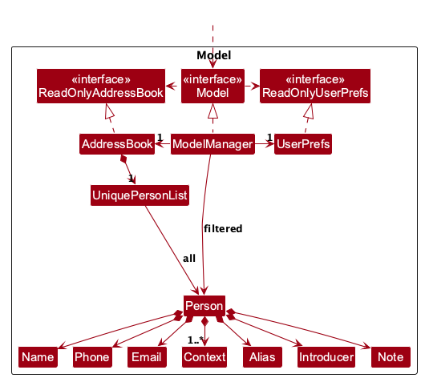
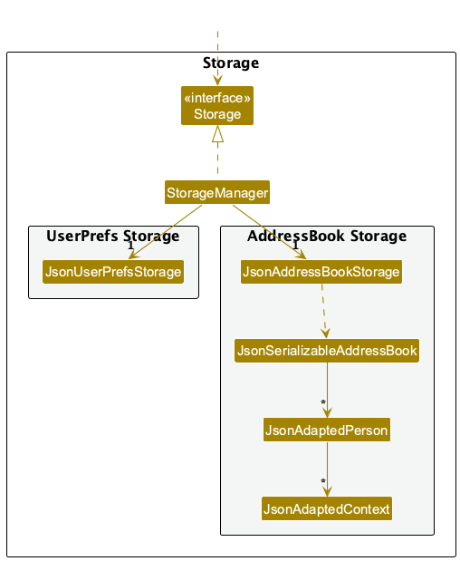
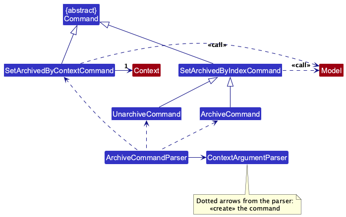
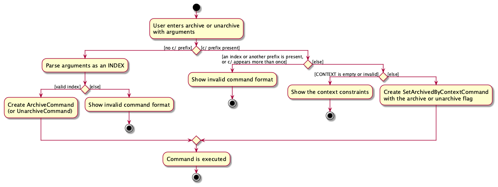
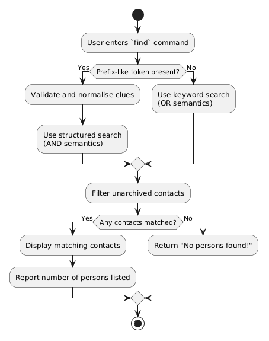
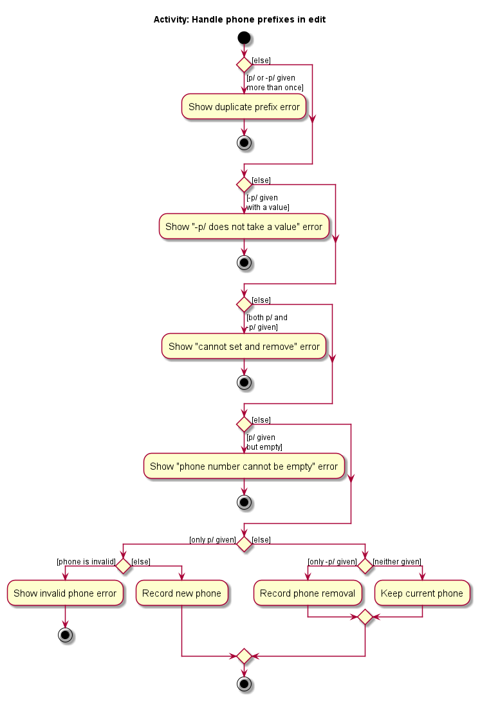

* Table of Contents
{:toc}

--------------------------------------------------------------------------------------------------------------------

## **Acknowledgements**

* _{List the sources of reused or adapted ideas, code, documentation, and third-party libraries here, with links to the originals.}_

--------------------------------------------------------------------------------------------------------------------

## **Setting up, getting started**

Refer to the guide [_Setting up and getting started_](SettingUp.md).

--------------------------------------------------------------------------------------------------------------------

## **Design**

:bulb: **Tip:** The `.puml` files used to create diagrams are in `docs/diagrams`. Refer to the [_PlantUML Tutorial_ at se-edu/guides](https://se-education.org/guides/tutorials/plantUml.html) to learn how to create and edit diagrams.

### Architecture

The ***Architecture Diagram*** given above explains the high-level design of the App.

The following provides a quick overview of the main components and their interactions.

**Main components of the architecture**

**`Main`** (consisting of classes [`Main`](https://github.com/AY2627S1-CS2103T-W10-2/tp/tree/master/src/main/java/seedu/address/Main.java) and [`MainApp`](https://github.com/AY2627S1-CS2103T-W10-2/tp/tree/master/src/main/java/seedu/address/MainApp.java)) is in charge of the app launch and shut down.
* At app launch, it initializes the other components in the correct sequence, and connects them up with each other.
* At shut down, it shuts down the other components and invokes cleanup methods where necessary.

The bulk of the app's work is done by the following four components:

* [**`UI`**](#ui-component): The UI of the App.
* [**`Logic`**](#logic-component): The command executor.
* [**`Model`**](#model-component): Holds the data of the App in memory.
* [**`Storage`**](#storage-component): Reads data from, and writes data to, the hard disk.

[**`Commons`**](#common-classes) represents a collection of classes used by multiple other components.

**How the architecture components interact with each other**

The *Sequence Diagram* below shows how the components interact with each other for the scenario where the user issues the command `delete 1`.

Each of the four main components (also shown in the diagram above),

* defines its *API* in an `interface` with the same name as the Component.
* provides its functionality through a concrete `{Component Name}Manager` class that implements the corresponding API interface.

For example, the `Logic` component defines its API in `Logic.java` and implements it in `LogicManager.java`. Other components interact with a component through its interface rather than its concrete class, preventing them from coupling to that component's implementation, as illustrated in the following partial class diagram.

The sections below give more details of each component.

### UI component

The **API** of this component is specified in [`Ui.java`](https://github.com/AY2627S1-CS2103T-W10-2/tp/tree/master/src/main/java/seedu/address/ui/Ui.java)

The UI consists of a `MainWindow` and its parts, such as `CommandBox`, `ResultDisplay`, `PersonListPanel`, and `StatusBarFooter`. All of these, including `MainWindow`, inherit from the abstract `UiPart` class, which captures common behavior among classes that represent visible GUI parts.

The `UI` component uses the JavaFX UI framework. The layouts of these UI parts are defined in matching `.fxml` files in `src/main/resources/view`. For example, [`MainWindow.fxml`](https://github.com/AY2627S1-CS2103T-W10-2/tp/tree/master/src/main/resources/view/MainWindow.fxml) specifies the layout of [`MainWindow`](https://github.com/AY2627S1-CS2103T-W10-2/tp/tree/master/src/main/java/seedu/address/ui/MainWindow.java).

The `UI` component,

* executes user commands using the `Logic` component.
* listens for changes to `Model` data so that the UI can be updated with the modified data.
* keeps a reference to the `Logic` component, because the `UI` relies on the `Logic` to execute commands.
* depends on some classes in the `Model` component because it displays `Person` objects from the model.

### Logic component

**API** : [`Logic.java`](https://github.com/AY2627S1-CS2103T-W10-2/tp/tree/master/src/main/java/seedu/address/logic/Logic.java)

Here's a (partial) class diagram of the `Logic` component:

The sequence diagram below illustrates the interactions within the `Logic` component, taking `execute("delete 1")` API call as an example.

:information_source: **Note:** The lifeline for `DeleteCommandParser` should end at the destroy marker (X), but due to a limitation of PlantUML, it continues to the end of the diagram.

How the `Logic` component works:

1. When `Logic` is called upon to execute a command, the command is passed to an `AddressBookParser` object, which in turn creates a parser that matches the command (e.g., `DeleteCommandParser`) and uses it to parse the command.
1. This results in a `Command` object (more precisely, an object of one of its subclasses e.g., `DeleteCommand`) which is executed by the `LogicManager`.
1. The command can communicate with the `Model` when it is executed (e.g. to delete a person). 
   Note that although this is shown as a single step in the diagram above for simplicity, the code can require several interactions between the command object and the `Model` to complete the operation.
1. The result of the command execution is encapsulated as a `CommandResult` object which is returned from `Logic`.

Here are the other classes in `Logic` (omitted from the class diagram above) that are used for parsing a user command:

How the parsing works:
* When called upon to parse a user command, the `AddressBookParser` class creates an `XYZCommandParser` (`XYZ` is a placeholder for the specific command name, e.g., `AddCommandParser`). The parser uses the other classes shown above to parse the user command and create an `XYZCommand` object (e.g., `AddCommand`). The `AddressBookParser` returns that object as a `Command` object.
* All `XYZCommandParser` classes, such as `AddCommandParser` and `DeleteCommandParser`, implement the `Parser` interface so they can be treated similarly where appropriate, for example during testing.

### Model component
**API** : [`Model.java`](https://github.com/AY2627S1-CS2103T-W10-2/tp/tree/master/src/main/java/seedu/address/model/Model.java)

The `Model` component,

* stores the address book data i.e., all `Person` objects (which are contained in a `UniquePersonList` object), whether they are archived or not.
* stores the `Person` objects selected by the current filter, such as search results, in a separate _filtered_ list. It exposes this list as an unmodifiable `ObservableList<Person>` that the UI can observe and bind to, so the UI updates when the list changes.
* shows only some of those objects at a time. The filtered list uses a `Predicate<Person>`: `PREDICATE_SHOW_ACTIVE` (persons who are not archived, the normal contact list and the list shown at start-up) or `PREDICATE_SHOW_ARCHIVED`. `Model#showingArchivesProperty()` tells the UI which of the two is in use. See [Archive feature](#archive-feature).
* stores a `UserPrefs` object that represents the user’s preferences (currently, just the GUI settings). This is exposed to the outside as a `ReadOnlyUserPrefs` object.
* does not depend on any of the other three components (as the `Model` represents data entities of the domain, they should make sense on their own without depending on other components)

### Storage component

**API** : [`Storage.java`](https://github.com/AY2627S1-CS2103T-W10-2/tp/tree/master/src/main/java/seedu/address/storage/Storage.java)

The `Storage` component,
* can save both address book data and user preference data in JSON format, and read them back into corresponding objects.
* saves every person, including archived ones, in the same file. A person's `archived` flag is stored as an optional `"archived"` key, which defaults to `false` when it is missing, so data files saved before archiving existed still load.
* is implemented by `StorageManager`, which delegates the actual JSON file access to `JsonAddressBookStorage` and `JsonUserPrefsStorage` (one class per data file).
* depends on some classes in the `Model` component (because the `Storage` component's job is to save/retrieve objects that belong to the `Model`)

### Common classes

Classes used by multiple components are in the `seedu.address.commons` package.

--------------------------------------------------------------------------------------------------------------------

## **Implementation**

This section describes some noteworthy details on how certain features are implemented.

### Context overview

The `contexts` command lists active persons' distinct contexts with person counts in the existing scrollable result display. `AddressBookParser` delegates to `ContextsCommandParser`, which rejects non-whitespace arguments with the usage message and a pointer to `find c/CONTEXT`. Command words remain case-insensitive. The command stays separate from `list`, as `archives` does; `list` continues to show active persons and ignore trailing arguments.

`ContextsCommand#execute()` reads `Model#getAddressBook().getPersonList()` rather than the filtered person list. It visits persons in their stored order, skips those that do not match `Model.PREDICATE_SHOW_ACTIVE`, and aggregates the remaining context descriptions in a `TreeMap` using `String.CASE_INSENSITIVE_ORDER`. This groups equivalent names and sorts the output while retaining the spelling from the first active person. Archived persons cannot contribute counts, context names or spelling. `Context` already normalizes surrounding and repeated spaces, and each person's contexts form a set, so a person contributes at most one to each context's count. Separate contacts with the same name are counted separately.

The command returns one line per context followed by a distinct-context summary. An empty address book gets the add-person hint; an address book containing only archived persons gets a separate no-active-contexts message with instructions to view and unarchive persons. It does not update the model or its filter, so the displayed person list, search predicate, Archives header and indices remain unchanged. Even in the archive view, the overview counts all active persons, rather than the displayed archived persons. Counts are recomputed on each execution, and no storage format change is required. Existing `LogicManager` save handling applies as it does for other commands.

`ContextsCommandTest` covers normalization, counts, alphabetical order, spelling from the first active person, empty and archived-only data, filtered lists, archive views and changes between executions. Parser tests cover command casing, whitespace and rejected arguments. `LogicManagerTest` verifies filtering, archive/unarchive transitions, preservation of the archive view, rejected input and counts after reloading saved contacts.

### Archive feature

#### Implementation

An archived contact is an ordinary `Person` whose `archived` flag is `true`. It stays in the same `AddressBook` and the same data file as every other person. What changes is which persons the user *sees*.

The user sees `ModelManager#filteredPersons`, a `FilteredList<Person>`. The list that is shown depends only on the predicate set on it, in the same way as for `find`:

| Command | Predicate set | What is shown |
|---------|---------------|---------------|
| _(start-up)_, `list`, `add`, `edit` | `PREDICATE_SHOW_ACTIVE` | persons who are not archived |
| `find KEYWORDS` | `PREDICATE_SHOW_ACTIVE.and(keyword predicate)` | matching persons who are not archived |
| `archives` | `PREDICATE_SHOW_ARCHIVED` | archived persons only |

Because the shown list is the predicate, no separate "view mode" is stored. The window shows the **Archives** header by binding to `Model#showingArchivesProperty()`, which is true only while the predicate is `PREDICATE_SHOW_ARCHIVED`. After a `find`, the predicate is a combined one, so the header is hidden.

The new commands follow the pattern of `delete`:

* `ArchiveCommand` and `UnarchiveCommand` take an `Index` that refers to `Model#getFilteredPersonList()`, that is, to the list on screen. The command finds the person, checks the flag (`archive` refuses a person who is already archived and `unarchive` refuses a person who is not), and replaces the person with `Person#copyWithArchived(boolean)`, which returns a copy with only the flag changed (`Person` is immutable). `LogicManager` then saves the whole address book as after every command.
* `ViewArchivesCommand` only sets `PREDICATE_SHOW_ARCHIVED`. Unlike the other commands without parameters, `ViewArchivesCommandParser` rejects text after the command word, because `archives` is one letter away from `archive` and `archives 1` is most likely a mistyped `archive 1`.

#### Archiving by context

`archive c/CONTEXT` and `unarchive c/CONTEXT` change every person who has the context, in one command. The classes involved are shown below.

* Archiving and unarchiving are the same change with opposite values, so each way of choosing persons has one command class with an `archived` flag: `SetArchivedByIndexCommand` (the index form) and `SetArchivedByContextCommand` (the `c/` form). `ArchiveCommand` and `UnarchiveCommand` are thin subclasses of `SetArchivedByIndexCommand`. They only give the command word, the usage message and the flag, so the code and tests that refer to them did not change.
* One `ArchiveCommandParser` serves both command words. `AddressBookParser` creates it with `true` for `archive` and with `false` for `unarchive`. It first asks `ContextArgumentParser` whether the arguments are in the `c/` form. If there is no `c/`, it continues with the index as before. This is why the parser returns `Command` and not `ArchiveCommand`.

`ContextArgumentParser` rejects `c/` together with an index or with any other prefix (for example `archive c/CS2103T n/John`), and rejects a repeated `c/`. It recognises every prefix defined in `CliSyntax` (including `+c/`, `-c/`, `-p/` and `-e/`) by tokenizing with `ArgumentTokenizer`, as `AddCommandParser` and `EditCommandParser` do, so the same rule decides where a prefix starts in every command: a prefix only counts after a space. A prefix added to `CliSyntax` must also be added to `ContextArgumentParser`; a test fails if it is not.

The sequence diagram shows what happens when the user enters `archive c/CS2103T`.

`unarchive c/CS2103T` is the same, with the flag `false`, so the command calls `copyWithArchived(false)`.

**Why two command classes.** `SetArchivedByIndexCommand` and `SetArchivedByContextCommand` are separate because the two forms behave differently, not only because they read different input. The index form points at one person on screen, so it reads `Model#getFilteredPersonList()` and reports a person who is already in the target state as an error (that is useful feedback for a single person). The context form asks for a group, so it reads the whole address book, skips persons who are already in the target state, and fails only if no person changes. Both build the changed copy with `Person#copyWithArchived(boolean)`. The Javadoc of each class names the other.

The command reads `Model#getAddressBook()` and **not** `Model#getFilteredPersonList()`. A context command has no index, so nothing ties it to what is on screen, and an earlier `find` must not change which persons it affects. The persons to change are copied into a list before the loop, because `Model#setPerson` changes the list that they were read from. Only persons whose state really changes are counted, and if there are none the command fails with a message that names the context. The context is matched with `Context#equals`, so it is exact and ignores capitalisation.

Because `unarchive` checks the flag of the person it finds, `unarchive 1` while the normal list is shown cannot change the wrong person: that person is not archived, so the command is refused with a message that says to run `archives` first.

Other commands take the archive into account as follows:

* `Person#isSamePerson` ignores the flag, so an archived person still blocks a new person with the same phone number or email, and `unarchive` can never create a duplicate.
* `edit` refuses an archived person.
* `clear` removes only persons who are not archived, so it cannot wipe the archive by accident.
* `delete` is unchanged. It deletes whichever person is shown, so it deletes an archived person while the archives are shown.

#### Storage format

`JsonAdaptedPerson` has an optional `archived` value. A missing or `null` value means `false`. It is read as a plain object and checked in `toModelType()`: only `true` or `false` is accepted, because Jackson alone would also turn values such as `5` into `true`. Any other value makes the data file invalid, which takes the normal path for an unreadable file (the file is renamed to a `.bak` file and the app starts empty).

#### Design considerations

**Aspect: How archived persons are stored**

* **Alternative 1 (current choice):** one list with an `archived` flag per person.
  * Pros: one data file and one save, so there is no half-finished move between two files; the duplicate check already covers archived persons; old data files load unchanged.
  * Cons: every command that shows a list must choose a predicate, or archived persons would appear; the flag touches `Person` and `JsonAdaptedPerson`.
* **Alternative 2:** a second address book and a second data file for the archive.
  * Pros: existing commands never see archived persons, so they cannot forget to filter them.
  * Cons: archiving writes two files, so a crash between the two writes loses or duplicates a person; the duplicate check must look in both address books; the UI must switch between two lists; and there are two files that can become unreadable.

**Aspect: How the app knows that the archives are shown**

* **Alternative 1 (current choice):** use the predicate on the filtered list as the only state.
  * Pros: nothing can disagree with it, and `find` already works this way.
* **Alternative 2:** store a separate view mode next to the predicate.
  * Cons: two copies of the same fact that can drift apart.

### Multi-clue search

#### Implementation

The `find` command supports two search modes while preserving the existing keyword-search behaviour:

* An unprefixed command such as `find Alex CS2103T` uses `PersonContainsKeywordsPredicate`. A person matches when
  any keyword occurs in the person's name or contexts.
* A structured command such as `find n/Alex c/CS2103T nt/project` uses `PersonMatchesCluesPredicate`. A person
  matches only when every supplied clue matches its corresponding field.

`FindCommandParser` uses `ArgumentTokenizer` with `n/`, `p/`, `e/`, `c/`, `a/`, `i/` and `nt/` to select the search
mode and read the clues. If none of these prefixes is recognised, it creates the existing keyword predicate. If at
least one is recognised, it creates the structured predicate. The prefixes may appear in any order. `n/`, `p/`, `e/`,
`a/`, `i/` and `nt/` may each appear at most once, while `c/` is repeatable. Other slash-containing text remains part
of a keyword or clue rather than being treated as an unsupported prefix.

Before constructing `PersonMatchesCluesPredicate`, the parser trims each clue, collapses repeated whitespace and
removes equivalent repeated context clues case-insensitively. Empty clues and unprefixed text before a recognised
structured clue are rejected without changing the current filtered list. The normalised values are collected in a
`PersonSearchClues` builder using field-named methods, avoiding ambiguous positional arguments for the similarly typed
optional clues.

`FindCommand` stores a `Predicate<Person>` rather than a concrete predicate type, allowing both search modes to share
the same command execution. In structured mode, `PersonMatchesCluesPredicate` checks each clue only against its
corresponding person field and combines all results using AND. Each individual context clue may match any one of the
person's contexts. A person with a missing optional field does not match a clue for that field. Comparisons are
case-insensitive partial matches, with repeated whitespace treated as one space.

This separation keeps the legacy name-and-context OR search unchanged without changing `FindCommand` execution.

### Edit feature

#### Implementation

Besides setting a field, `edit` can remove the phone number, email, alias, introducer or note with `-p/`, `-e/`, `-a/`,
`-i/` or `-nt/`. `EditCommandParser` records the requested changes in an `EditCommand.EditPersonDescriptor`. Each of
those five fields is held as a `FieldEdit`, which leaves the field unchanged, sets it to a new value, or removes it, so
a field cannot be both set and removed. `EditCommand` applies each `FieldEdit` to a copy of the person with
`FieldEdit#applyTo`, because `Person` is immutable.

The activity diagram below shows how the parser handles the phone prefixes. Checks on other parts of the command,
such as the index and the name, are left out.

Each check rejects the command with its own error. When a command breaks more than one rule, the order of the checks
decides which error the user sees. For example, `edit 1 p/ -p/` is rejected because it sets and removes the phone
number, not because `p/` is empty. Removing uses its own prefix instead of an empty `p/`, because an empty `p/` is
easy to send by accident, such as by pressing Enter before typing the number. The error for an empty `p/` points the
user to `-p/`.

The diagram uses phone as the example, but the activity is the same for every other removable field and its removal
prefix (such as `e/` and `-e/`). Only the prefixes change. The one exception is the note: `nt/` takes the rest of the
line, so a second `nt/` becomes part of the note instead of being rejected as a duplicate prefix. The activity is the
same because every removable field goes through the same checks in `EditCommandParser#parseOptionalField`. An
`OptionalField` record configures that method for each field with the set and remove prefixes, the wording used in
error messages, and the parser for the value. Adding another removable field means adding one more `OptionalField`, not
another parse method. The value itself is parsed by `ParserUtil#parseIfPresent`, which `AddCommandParser` uses as well.

### \[Proposed\] Undo/redo feature

#### Proposed Implementation

The proposed undo/redo mechanism is facilitated by `VersionedAddressBook`. It extends `AddressBook` with an undo/redo history, stored internally as an `addressBookStateList` and `currentStatePointer`. Additionally, it implements the following operations:

* `VersionedAddressBook#commit()` — Saves the current address book state in its history.
* `VersionedAddressBook#undo()` — Restores the previous address book state from its history.
* `VersionedAddressBook#redo()` — Restores a previously undone address book state from its history.

These operations are exposed in the `Model` interface as `Model#commitAddressBook()`, `Model#undoAddressBook()` and `Model#redoAddressBook()` respectively.

Given below is an example usage scenario and how the undo/redo mechanism behaves at each step.

Step 1. The user launches the application for the first time. The `VersionedAddressBook` will be initialized with the initial address book state, and the `currentStatePointer` pointing to that single address book state.

Step 2. The user executes `delete 5` command to delete the 5th person in the address book. The `delete` command calls `Model#commitAddressBook()`, causing the modified state of the address book after the `delete 5` command executes to be saved in the `addressBookStateList`, and the `currentStatePointer` is shifted to the newly inserted address book state.

Step 3. The user executes `add n/David …​` to add a new person. The `add` command also calls `Model#commitAddressBook()`, causing another modified address book state to be saved into the `addressBookStateList`.

:information_source: **Note:** If a command fails its execution, it will not call `Model#commitAddressBook()`, so the address book state will not be saved into the `addressBookStateList`.

Step 4. The user now decides that adding the person was a mistake, and decides to undo that action by executing the `undo` command. The `undo` command will call `Model#undoAddressBook()`, which will shift the `currentStatePointer` once to the left, pointing it to the previous address book state, and restores the address book to that state.

:information_source: **Note:** If the `currentStatePointer` is at index 0, pointing to the initial AddressBook state, then there are no previous AddressBook states to restore. The `undo` command uses `Model#canUndoAddressBook()` to check if this is the case. If so, it will return an error to the user rather
than attempting to perform the undo.

The following sequence diagram shows how an undo operation goes through the `Logic` component:

:information_source: **Note:** The lifeline for `UndoCommand` should end at the destroy marker (X), but due to a limitation of PlantUML, it continues to the end of the diagram.

Similarly, how an undo operation goes through the `Model` component is shown below:

The `redo` command does the opposite — it calls `Model#redoAddressBook()`, which shifts the `currentStatePointer` once to the right, pointing to the previously undone state, and restores the address book to that state.

:information_source: **Note:** If the `currentStatePointer` is at index `addressBookStateList.size() - 1`, pointing to the latest address book state, then there are no undone AddressBook states to restore. The `redo` command uses `Model#canRedoAddressBook()` to check if this is the case. If so, it will return an error to the user rather than attempting to perform the redo.

Step 5. The user then decides to execute the command `list`. Commands that do not modify the address book, such as `list`, will usually not call `Model#commitAddressBook()`, `Model#undoAddressBook()` or `Model#redoAddressBook()`. Thus, the `addressBookStateList` remains unchanged.

Step 6. The user executes `clear`, which calls `Model#commitAddressBook()`. Since the `currentStatePointer` is not pointing at the end of the `addressBookStateList`, all address book states after the `currentStatePointer` will be purged. Reason: It no longer makes sense to redo the `add n/David …​` command. This is the behavior that most modern desktop applications follow.

The following activity diagram summarizes what happens when a user executes a new command:

#### Design considerations:

**Aspect: How undo & redo execute:**

* **Alternative 1 (current choice):** Saves the entire address book.
  * Pros: Easy to implement.
  * Cons: May have performance issues in terms of memory usage.

* **Alternative 2:** Individual command knows how to undo/redo by
  itself.
  * Pros: Will use less memory (e.g. for `delete`, just save the person being deleted).
  * Cons: We must ensure that the implementation of each individual command is correct.

_{more aspects and alternatives to be added}_

--------------------------------------------------------------------------------------------------------------------

## **Documentation, logging, testing, dev-ops**

* [Documentation guide](Documentation.md)
* [Testing guide](Testing.md)
* [Logging guide](Logging.md)
* [DevOps guide](DevOps.md)

--------------------------------------------------------------------------------------------------------------------

## **Appendix: Requirements**

### Product scope

**Target user profile**:

* is a Computer Science (CS) student at university
* actively builds and maintains academic and professional networks through modules, project teams, hackathons, tech communities, internships and other collaborative activities
* accumulates contacts across many overlapping academic and professional contexts
* often remembers the context in which they know someone, but not the person's exact details
* has a need to manage a significant number of contacts
* prefers desktop apps over other types of applications
* can type fast
* prefers typing to mouse interactions
* is reasonably comfortable using CLI apps

**Value proposition**: Help CS students organise and retrieve people in their academic and professional network, especially when they remember the context in which they know someone but not the person's exact details. Each contact is saved with one or more contexts (e.g. a module, project team, hackathon or internship), so users can find the right person by name or context, faster than with a typical mouse-driven contact app.

### User stories

Priorities: High (must have) - `* * *`, Medium (nice to have) - `* *`, Low (unlikely to have) - `*`

The stories below cover UniContacts' core requirements, post-MVP candidates, and ideas considered but excluded from the product scope. They record the team's scope decisions at the MVP stage, rather than the current implementation status of each feature.

US1 to US22 retain the identifiers from the Project Notes.

#### Core requirements

| ID | Priority | As a ... | I want to ... | So that I can ... |
| --- | --- | --- | --- | --- |
| US1 | `* * *` | CS student who meets people at hackathons or datathons | record where and how I met someone when adding their contact | recall the connection even if I later forget their name |
| US4 | `* * *` | CS student with limited time | quickly add a contact with a name and context, even when I do not yet have their phone number or email | capture people I meet before I forget their details |
| US5 | `* * *` | CS student who meets people through different activities | organise contacts using contexts such as modules, clubs, internships, and events | remember which parts of my network each person belongs to |
| US10 | `* * *` | CS student who remembers an activity but not someone's name | search contacts by their associated module, event, project, or organisation | find the right person using the context I remember |
| US11 | `* * *` | CS student who knows someone through several activities | associate multiple contexts with the same contact | keep those connections together without creating a separate entry for each context |
| US15 | `* * *` | CS student who remembers only part of a name | search contacts using a full or partial name regardless of capitalisation | find someone without remembering their exact full name |
| US16 | `* * *` | CS student who knows people with similar names | see contextual information alongside search results | distinguish between the matching contacts |
| US17 | `* *` | CS student who remembers several partial details about someone | narrow search results to contacts matching all the clues I provide | identify the person from the combination of details I remember |
| US18 | `* * *` | CS student reconnecting with people from a particular activity | view contacts associated with a module, event, project, or organisation | rediscover people from that group |
| US23 | `* *` | CS student with contacts from many activities | view my active contexts and the number of contacts linked to each | choose a relevant group before searching my network |

Context-based search (US10) directly supports UniContacts' value proposition: retrieving people through the contexts
in which the user knows them. Multi-clue search (US17) extends this by requiring every supplied field-specific clue to
match the same contact.

#### Post-MVP candidates

These stories record useful extensions considered beyond the MVP. Their priorities express their relative importance. Some were implemented after the MVP, while others remain possible future enhancements.

| ID | Priority | As a ... | I want to ... | So that I can ... |
| --- | --- | --- | --- | --- |
| US3 | `* *` | CS student looking for teammates or collaborators | filter contacts by skills, interests, or past project experience | find suitable people for future projects or hackathons |
| US6 | `* *` | CS student maintaining relationships | set reminders to check in with contacts | avoid losing touch with people in my network |
| US7 | `*` | CS student building a network | record and view which of my contacts know each other | understand the connections within my network |
| US8 | `* *` | CS student keeping track of friends' activities | record and view notes about a contact's current role, project, or location | recall what they are doing without asking for the same information again |
| US9 | `* *` | CS student exploring career paths | search or filter contacts by role, company, or field | identify people whose experience is relevant to my career interests |
| US12 | `* *` | CS student who connects with people through different channels | store additional contact channels, such as Telegram handles, alongside phone numbers and email addresses | choose an appropriate way to reach each person |
| US13 | `* *` | CS student whose project team or module has ended | archive contacts I no longer actively need | keep my active list relevant while retaining past connections |
| US14 | `* *` | CS student who regularly contacts a few key people | mark contacts as favourites | access them quickly without searching the whole list |
| US19 | `* *` | CS student who met someone through another person | record who introduced me to a contact | remember how the connection was formed |
| US20 | `* *` | CS student whose contacts' details and shared activities change | edit contact details and add or remove contexts | keep records accurate without deleting and recreating contacts |
| US21 | `* *` | CS student who knows someone by more than one name | record and search a contact's nickname or alternative name | find them using the name I remember |
| US22 | `* *` | CS student who needs to remember additional details about a person | attach a short personal note to a contact | retain useful information that does not fit the standard contact fields |

The MVP already allows optional phone and email details; US12 extends this to additional channels. US13, US19,
US20, US21 and US22 were implemented after the MVP; their placement here records the original MVP scope.
The other stories remain possible future enhancements.

#### Considered but excluded

The following story is retained to document the scope decision. UniContacts manages a student's personal contacts; social discovery is outside its intended scope. The priority records the desirability of the idea, not a commitment to implement it.

| ID | Priority | As a ... | I want to ... | So that I can ... |
| --- | --- | --- | --- | --- |
| US2 | `* *` | CS student seeking social connections | discover and start conversations with other students who share my interests | make friends beyond my existing contacts |

### Use cases

(For all use cases below, the **System** is `UniContacts` and the **Actor** is the `user`. Steps state the user's intention rather than command syntax; command formats and error messages are specified in the User Guide.)

**Use case: UC01 - Add a contact**

**Guarantees**

* If the entered data is invalid or duplicates an existing contact, no contact is added.
* Otherwise, the new contact is stored with its name and at least one context.

**MSS**

1.  User requests to add a contact, providing the contact's name, at least one context, and optionally a phone number and email
2.  System adds the contact and shows the details of the new contact

    Use case ends.

**Extensions**

* 1a. System detects an error in the entered data.

    * 1a1. System shows an error message with the correct format.

    * 1a2. User enters new data.

      Steps 1a1-1a2 are repeated until the data entered are correct.

      Use case resumes at step 2.

* 1b. The phone number or email matches an existing contact.

    * 1b1. System informs the user that the contact already exists.

      Use case ends.

* 2a. System is unable to save the change.

    * 2a1. System adds the contact for the current session and warns the user that the change may be lost when the app is closed.

      Use case ends.

**Use case: UC02 - Find contacts by context**

**Guarantees**

* No contact data is changed.
* Every saved contact with a context matching the request is shown, regardless of capitalisation.

**MSS**

1.  User requests to find contacts linked to a specific context
2.  System shows the matching contacts filtered by that specific context

    Use case ends.

**Extensions**

* 1a. User does not remember the exact context.

    * 1a1. User views all contexts (UC06).

      Use case resumes at step 1.

* 1b. User does not specify a context.

    * 1b1. System shows an error message with the correct format.

      Use case resumes at step 1.

* 2a. No contacts match the context.

    * 2a1. System shows an empty list and informs the user that no contacts were found.

      Use case ends.

**Use case: UC03 - Find contacts by name**

**Guarantees**

* No contact data is changed.
* Every saved contact whose name contains the requested name is shown, regardless of capitalisation.

**MSS**

1.  User requests to find contacts by a full or partial name
2.  System shows the matching contacts, each with its contexts

    Use case ends.

**Extensions**

* 1a. User does not specify a name.

    * 1a1. System shows an error message with the correct format.

      Use case resumes at step 1.

* 2a. No contacts match the name.

    * 2a1. System shows an empty list and informs the user that no contacts were found.

      Use case ends.

**Use case: UC04 - Find contacts using multiple clues**

**Guarantees**

* No contact data is changed.
* Every displayed contact matches every supplied name and context clue, regardless of capitalisation.

**MSS**

1.  User requests to find contacts using one or more partial name and context clues
2.  System searches the full contact list and shows contacts matching every clue

    Use case ends.

**Extensions**

* 1a. User does not provide a name or context clue.

    * 1a1. System shows an error message with the correct format.

      Use case resumes at step 1.

* 1b. User mixes unprefixed keywords with prefixed clues.

    * 1b1. System shows an error message explaining the correct formats.

      Use case resumes at step 1.

* 2a. No contact matches every clue.

    * 2a1. System shows an empty list and informs the user that no contacts were found.

      Use case ends.

**Use case: UC05 - Delete a contact**

**Guarantees**

* If the user does not identify a contact in the displayed list, no contact is deleted.
* Only the identified contact is deleted; other contacts, including ones with the same name, are unchanged.
* The deleted contact no longer appears in the contact list.

**MSS**

1.  User requests to list contacts
2.  System shows a list of contacts
3.  User requests to delete a specific contact in the list
4.  System deletes the contact and shows the details of the deleted contact

    Use case ends.

**Extensions**

* 1a. User finds the contact by context (UC02) or by name (UC03) instead.

  Use case resumes at step 3.

* 2a. The list is empty.

  Use case ends.

* 3a. The requested contact is not in the displayed list.

    * 3a1. System shows an error message.

      Use case resumes at step 2.

* 4a. System is unable to save the change.

    * 4a1. System deletes the contact for the current session and warns the user that the change may be lost when the app is closed.

      Use case ends.

**Use case: UC06 - View all contexts**

**Guarantees**

* No contact data is changed, and the displayed contact list is unchanged.
* Each context appears once, regardless of capitalisation or extra spaces.
* Counts include every active contact in the address book, regardless of the current search filter or archive view.
* Archived contacts contribute neither counts nor context names. Spelling comes from the first active contact.
* Each contact contributes at most one to each context's count. Different contacts with the same name count separately.

**MSS**

1.  User requests to view all contexts
1.  System shows each context in alphabetical order, with the number of active contacts linked to it

    Use case ends.

**Extensions**

* 1a. The request contains unsupported parameters.

    * 1a1. System shows an error with usage guidance and a pointer to context search.

      Use case resumes at step 1.

* 2a. No contacts have been saved.

    * 2a1. System informs the user that there are no contexts yet.

      Use case ends.

* 2b. All saved contacts are archived.

    * 2b1. System reports that there are no active contexts and explains how to view and unarchive contacts.

      Use case ends.

**Use case: UC07 - Archive a contact**

**Guarantees**

* If the user does not identify a contact in the displayed list, or the contact is already archived, nothing is changed.
* Only the identified contact is archived; other contacts are unchanged.
* The archived contact is not deleted: it stays saved with all its details.
* The archived contact no longer appears in the contact list or in find results.

**MSS**

1.  User requests to list contacts
2.  System shows a list of contacts
3.  User requests to archive a specific contact in the list
4.  System archives the contact and shows the details of the archived contact

    Use case ends.

**Extensions**

* 1a. User finds the contact by context (UC02) or by name (UC03) instead.

  Use case resumes at step 3.

* 2a. The list is empty.

  Use case ends.

* 3a. The requested contact is not in the displayed list.

    * 3a1. System shows an error message.

      Use case resumes at step 2.

* 3b. The requested contact is already archived.

    * 3b1. System shows an error message.

      Use case resumes at step 2.

* 3c. User requests to archive all contacts with a context instead of one contact.

    * 3c1. System archives every contact with that context who is not archived yet, whatever contacts the list shows, and shows how many were archived.

      Use case ends.

    * 3c2. No contact with that context can be archived, or the context is not valid.

        * 3c2a. System shows an error message.

          Use case resumes at step 2.

* 4a. System is unable to save the change.

    * 4a1. System archives the contact for the current session and warns the user that the change may be lost when the app is closed.

      Use case ends.

**Use case: UC08 - View archived contacts**

**Guarantees**

* No contact data is changed.
* Only archived contacts are shown, under the heading "Archives".

**MSS**

1.  User requests to view archived contacts
2.  System shows the archived contacts under the heading "Archives"

    Use case ends.

**Extensions**

* 1a. The request has extra text after it (for example, `archives 1`).

    * 1a1. System shows an error message.

      Use case resumes at step 1.

* 2a. There are no archived contacts.

    * 2a1. System tells the user that there are no archived contacts.

      Use case ends.

**Use case: UC09 - Unarchive a contact**

**Guarantees**

* If the user does not identify an archived contact in the displayed list, nothing is changed.
* Only the identified contact is unarchived; other contacts are unchanged.
* The unarchived contact appears in the normal contact list again.

**MSS**

1.  User views the archived contacts (UC08)
2.  User requests to unarchive a specific contact in the list
3.  System unarchives the contact and shows the details of the unarchived contact

    Use case ends.

**Extensions**

* 2a. The requested contact is not in the displayed list.

    * 2a1. System shows an error message.

      Use case resumes at step 1.

* 2b. The requested contact is not archived, for example because the normal list is shown.

    * 2b1. System shows an error message that tells the user to view the archived contacts first.

      Use case resumes at step 1.

* 2c. User requests to unarchive all contacts with a context instead of one contact.

    * 2c1. System unarchives every archived contact with that context, whatever contacts the list shows, and shows how many were unarchived.

      Use case ends.

    * 2c2. No archived contact has that context, or the context is not valid.

        * 2c2a. System shows an error message.

          Use case resumes at step 1.

* 3a. System is unable to save the change.

    * 3a1. System unarchives the contact for the current session and warns the user that the change may be lost when the app is closed.

      Use case ends.

### Non-Functional Requirements

1.  UniContacts should work on Windows, Linux, and macOS computers with Java `25` installed.
2.  UniContacts should be distributed as a single JAR file no larger than 100 MB and should not require an installer.
3.  All features should remain usable without an Internet connection, a user account, or a remote server.
4.  Contact data should be stored locally in a human-editable text file without using a database management system. Correctly formatted manual edits to the data file should be loaded by the application.
5.  UniContacts should support a single user per installation and should not require its data file to be shared or accessed concurrently.
6.  Contact data should not be transmitted outside the user's computer.
7.  UniContacts should be able to hold up to 1000 contacts. Commands used during typical operation, such as adding, editing, deleting, listing, and finding contacts, should complete within one second.
8.  A user with above-average typing speed for regular English text should be able to perform all primary contact-management tasks using only the keyboard and faster than with an equivalent mouse-driven interface.
9.  The GUI should work well at resolutions of `1920x1080` and above with screen scales of 100% and 125%. It should remain usable at resolutions of `1280x720` and above with a screen scale of 150%.
10. Invalid commands and invalid contact details entered by the user should not modify existing contact data or cause the application to stop responding. The application should display an error message and remain usable.

### Glossary

* **Hackathon**: A collaborative event for programmers to work intensively to build functional software or hardware prototypes.
* **Datathon**: A collaborative competition—similar to a hackathon—where participants analyze complex, real-world datasets to build data-driven applications, machine learning models, or strategic insights within a set timeframe
* **Duplicate**: The input is considered as a duplicate when the email/phone number inputted matches one of stored emails/phone numbers in the database. Inputs with same name matched is allowed and will not be considered as a duplicate.
* **Capitalisation**: Whether the letters in a context name are uppercase or lowercase.
* **Contact**: A saved record representing a specific person within the user's academic, professional, or social network.
* **Context**: A descriptive tag representing the shared environment, activity, or relationship (such as a school module, project team, CCA, internship, or event) that explains how or where the user knows a specific person.
* **Archived contact**: A contact that has been set aside with `archive`. It stays saved but is left out of the normal contact list and out of `find` results, and it is shown only by `archives`.
* **Index**: A numerical value used to identify and select a specific contact based on its position in the currently displayed contact list.
* **Partial-match**: A name/context input can match to multiple contacts in the local JSON.
* **Case-insensitive**: No distinctions between uppercase and lowercase inputs including commands, names and contexts.
* **Session**: A single continuous period of using UniContacts, starting when the application is opened and ending when it is closed.

*{More to be added}*

--------------------------------------------------------------------------------------------------------------------

## **Appendix: Instructions for manual testing**

Given below are instructions to test the app manually.

:information_source: **Note:** These instructions only provide a starting point for testers to work on;
testers are expected to do more *exploratory* testing.

### Launch and shutdown

1. Initial launch

   1. Download the JAR file and copy it into an empty folder.

   1. Double-click the JAR file. 
      Expected: The GUI opens with a set of sample contacts. The window size may not be optimal.

1. Saving window preferences

   1. Resize the window to an optimal size. Move the window to a different location. Close the window.

   1. Relaunch the app by double-clicking the JAR file. 
       Expected: The most recent window size and location are retained.

1. _{ more test cases …​ }_

### Finding a person using multiple clues

1. Matching clues across all supported fields

   1. Prerequisites: Add a contact using `add n/Tony Zhang p/91234567 e/tony@example.com c/CS2103T`
      `c/Hack&Roll a/Toto i/Alice Tan nt/Project teammate`.

   1. Test case: `find nt/project c/Hack p/9123 n/tony i/alice e/@example a/toto c/2103` 
      Expected: Tony Zhang is the only displayed contact. The order of the prefixes does not affect the result.

   1. Test case: `find n/Tony c/CS2103T nt/internship` 
      Expected: No contacts are displayed and the status message is `No persons found!`, because every clue must match.

   1. Test case: `find p/` 
      Expected: The displayed list is unchanged and the status message is `Phone search clue cannot be empty.`

   1. Test case: `find a/Toto a/TZ` 
      Expected: The displayed list is unchanged and the status message reports that `a/` was specified more than once.

### Deleting a person

1. Deleting a person while all persons are being shown

   1. Prerequisites: List all persons using the `list` command, with multiple persons in the list.

   1. Test case: `delete 1` 
      Expected: The first contact is deleted from the list. The status message shows the deleted contact's details.

   1. Test case: `delete 0` 
      Expected: No person is deleted. The status message shows error details.

   1. Other incorrect delete commands to try: `delete`, `delete x`, `...` (where x is larger than the list size) 
      Expected: Similar to previous.

1. _{ more test cases …​ }_

### Viewing all contexts

1. Listing counts and preserving a search filter

   1. Prerequisites: Use a disposable test address book containing only Alex Tan with `CS2103` and `NUS Hackers`, Priya Nair with `cs2103` and `CS2103T`, and Marcus Lim with `CS2103T`. All three must be active.

   1. Test case: `contexts` 
      Expected: The result display shows `CS2103: 2 people`, `CS2103T: 2 people`, `NUS Hackers: 1 person`, a blank line, and `3 contexts listed.` The contact list is unchanged.

   1. Test case: `find Priya`, followed by `contexts` 
      Expected: The same counts across all active contacts are shown, and only Priya remains in the displayed list.

   1. Test case: `find Nobody`, followed by `CONTEXTS` 
      Expected: The same counts are shown, and the displayed contact list remains empty.

   1. Test case: `list`, `delete 1`, then `contexts` 
      Expected: `NUS Hackers` disappears, and the counts reflect the remaining contacts. The overview uses Priya's spelling `cs2103` for that context.

1. Rejecting unexpected arguments

   1. Test cases: `contexts CS2103T`, `CONTEXTS c/CS2103T`, `contexts archived` and `contexts 1` 
      Expected: Each command fails with `Invalid command format!` and usage guidance pointing to `find c/CONTEXT`. The saved contacts and displayed list are unchanged.

1. Excluding archived contacts and preserving the archive view

   1. Prerequisites: Reset the disposable address book to the three active contacts in the first test group.

   1. Test case: `list`, `archive 1`, then `contexts` 
      Expected: `cs2103: 1 person`, `CS2103T: 2 people`, a blank line, and `2 contexts listed.` `NUS Hackers` is omitted, and Priya's spelling is used. Only Priya and Marcus remain in the displayed list.

   1. Test case: `archives`, then `contexts` 
      Expected: The same active-only overview is shown. Alex remains the only displayed contact, under the Archives header, at index 1.

   1. Close and reopen the app, then run `contexts`. 
      Expected: The same active-only counts and spelling are shown after reload.

   1. Test case: `archives`, `unarchive 1`, then `contexts` 
      Expected: The original three-context overview is restored, including Alex's spelling `CS2103`.

1. Listing contexts when all contacts are archived

   1. Prerequisites: In a disposable address book containing only the three active contacts above, run `list`, then `archive 1` three times.

   1. Test case: `contexts` 
      Expected: `No active contexts found. Run archives to view archived persons, then use unarchive INDEX to include them.` The displayed list remains empty.

   1. Test case: `archives`, then `contexts` 
      Expected: The same message, with all three archived contacts still displayed under the Archives header.

1. Listing contexts in an empty address book

   1. Prerequisites: Use an empty disposable address book with no active or archived contacts. `clear` alone does not remove archived contacts; use `archives` and delete those contacts individually if any remain.

   1. Test case: `contexts` 
      Expected: `No contexts found. Add a person with c/CONTEXT to get started.` The contact list remains empty.

1. Checking persistence and long output

   1. Close and reopen the app after saving contacts, then run `contexts`. 
      Expected: The counts and spelling match the stored active contacts.

   1. With enough distinct contexts to exceed the result display's height, run `contexts` and scroll the result. 
      Expected: All context rows and the final summary can be read without changing the displayed contact list.

### Archiving a person

1. Archiving, viewing and unarchiving

   1. Prerequisites: Start with the sample data (delete `data/addressbook.json` first if there is one). Run `list`.

   1. Test case: `archive 2` 
      Expected: The 2nd person disappears from the list. The result display shows `Archived person:` and the person's details.

   1. Test case: `list` 
      Expected: The archived person is not shown.

   1. Test case: `archives` 
      Expected: The heading **Archives** is shown above the list. Only the archived person is listed, as number 1. The result display shows `Listed 1 archived person.`

   1. Test case: `unarchive 1` (while the archives are shown) 
      Expected: The person leaves the archived list. The result display shows `Unarchived person:` and the details. Run `list` to confirm that the person is back in the normal list.

1. Archiving and unarchiving by context

   1. Prerequisites: Start with the sample data. Run `list` and note which persons have the context `CS2103T`.

   1. Test case: `archive c/CS2103T` 
      Expected: Every person with the context `CS2103T` disappears from the list, whatever else the list showed before. The result display shows `Archived N person(s) with context CS2103T.`, where `N` is the number of those persons.

   1. Test case: `find n/Alex` followed by `archive c/CS2103T` 
      Expected: The persons with the context `CS2103T` are archived, not only the ones that `find` showed.

   1. Test case: `archive c/cs2103t` after the test case above 
      Expected: Nothing changes. The result display shows `No persons to archive with context cs2103t.` The context is matched ignoring capitalisation, so it was the same context, and everyone with it is archived already.

   1. Test case: `archives`, then `unarchive c/CS2103T` 
      Expected: The result display shows `Unarchived N person(s) with context CS2103T.` Run `list` to confirm that the persons are back.

   1. Test case: `unarchive c/CS2103T` again 
      Expected: `No archived persons with context CS2103T.`

   1. Other incorrect commands to try: `archive c/`, `archive c/(orbital)`, `archive c/CS2103T n/John`, `archive 1 c/CS2103T`, `archive c/CS2103T c/Hiking club`, and the same with `unarchive` 
      Expected: No person changes. The result display shows an error message.

1. Archived persons stay out of the normal list

   1. Prerequisites: Archive one person, for example `archive 1`, and remember their name.

   1. Test case: `find` with that person's name 
      Expected: `No persons found!` The person is not found.

   1. Test case: `edit 1 n/Changed` after `archives` 
      Expected: `This person is archived and can't be edited. Unarchive the person first.`

   1. Test case: `clear` 
      Expected: All other persons are cleared. The result display shows `Persons cleared. 1 archived person was kept.` `archives` still shows the person.

1. Incorrect commands

   1. Test case: `unarchive 1` while the normal list is shown 
      Expected: Nothing changes. The result display shows `That person is not archived. Run archives to see archived persons, then use unarchive INDEX.`

   1. Test case: `archive 1` while the archives are shown 
      Expected: `That person is already archived.`

   1. Test case: `archives 1` 
      Expected: The list does not change. The result display shows `Invalid command format!` followed by the usage of `archives`, as `archives` does not accept anything after it.

   1. Other incorrect commands to try: `archive`, `archive 0`, `archive x`, `archive 99` (larger than the list size), `unarchive 99` 
      Expected: No person changes. The result display shows an error message.

1. Archived persons are saved

   1. Prerequisites: Archive a person, then close and start the app again.

   1. Test case: `list` and then `archives` 
      Expected: The person is still archived: it is not in the normal list and it is shown by `archives`.

   1. Test case: Close the app, change a person's `"archived"` value in `data/addressbook.json` to `"yes"`, and start the app 
      Expected: The data file cannot be read, so the app starts with an empty list and keeps the file as `addressbook.json.<UTC time>.bak`.

### Saving data

1. Dealing with a missing data file

   1. Prerequisites: Close the app and delete the `data` folder.

   1. Test case: Start the app 
      Expected: The app starts with the sample contacts. `data/addressbook.json` is not created until a command that changes something, such as `add`, is run.

1. Dealing with corrupted data files

   1. Prerequisites: Close the app and make sure the `data` folder exists. It is created by the first command that changes something, such as `add`, so if you ran the test above, start the app, run `add n/Temp c/CS2103T` and close the app again. Make a copy of `data/addressbook.json` so you can restore it afterwards.

   1. Test case: Replace the content of `data/addressbook.json` with `{ "persons" : [` (not valid JSON), and start the app 
      Expected: The app starts with an empty list. The data file is renamed to `addressbook.json.<UTC time>.bak` in the `data` folder, and the log file `unicontacts.log.0` explains why the file could not be read.

   1. Test case: Delete the `contexts` of one person in `data/addressbook.json` (or give two persons the same phone number), and start the app 
      Expected: Same as above. The whole file is treated as unreadable, even though only one person is invalid.

   1. Test case: After either test above, run `add n/Test c/CS2103T` 
      Expected: A new `data/addressbook.json` is created with only the new person. The `.bak` file is not changed.

1. Dealing with a data file that cannot be written

   1. Prerequisites: Close the app and make sure the `data` folder exists (see the prerequisites of the test above). Make the `data` folder read-only (for example, `chmod 555 data` on macOS or Linux), and then start the app. Afterwards, make it writable again (for example, `chmod 755 data`).

   1. Test case: `add n/Test c/CS2103T` 
      Expected: The result display shows an error saying the data could not be saved because of insufficient permissions. The new person still appears in the list for this session, but is not in `data/addressbook.json`.

   1. Test case: `list` 
      Expected: The command succeeds, because commands that change nothing do not save.
