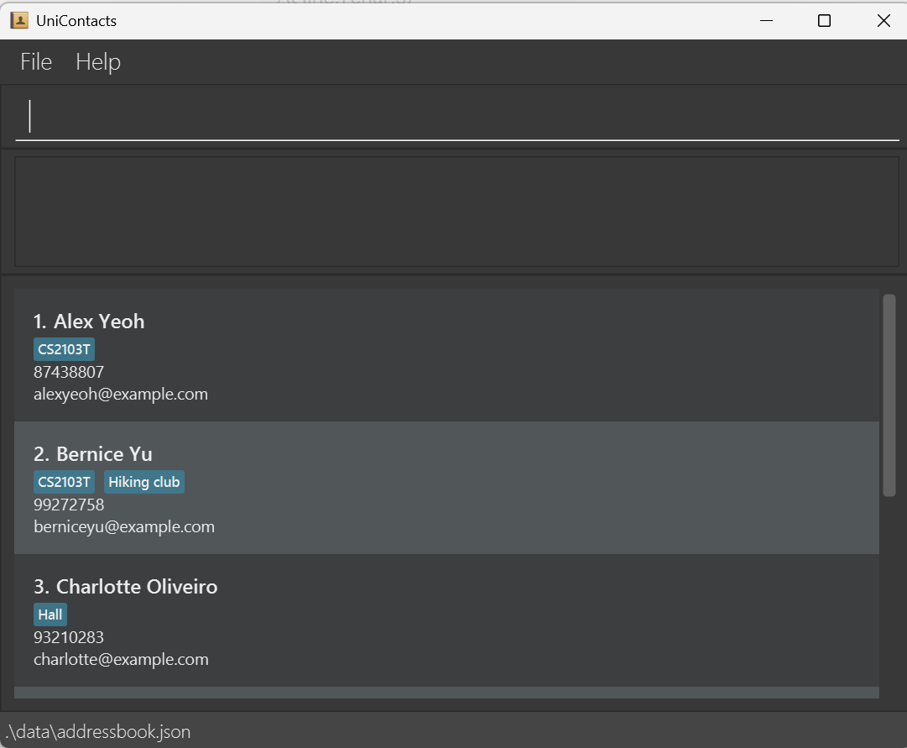

AddressBook Level 3 (AB3) is a **desktop application for managing contacts, optimized for use through a Command Line Interface (CLI)** while retaining the benefits of a Graphical User Interface (GUI). If you type quickly, AB3 can help you manage contacts faster than traditional GUI applications.

* Table of Contents
{:toc}

--------------------------------------------------------------------------------------------------------------------

## Quick start

1. Ensure that Java `25` or later is installed on your computer.<br>
   **Mac users:** Ensure you have the precise JDK version prescribed [here](https://se-education.org/guides/tutorials/javaInstallationMac.html).

1. Download the latest `.jar` file from [here](https://github.com/se-edu/addressbook-level3/releases).

1. Copy the file to the folder you want to use as the _home folder_ for your AddressBook.

1. Open a terminal, `cd` to the folder containing the JAR file, and run `java -jar addressbook.jar`.<br>
   A GUI similar to the one below should appear in a few seconds. Note how the app contains some sample data.<br>
   

1. Type a command in the command box and press Enter to execute it. For example, type **`help`** and press Enter to open the help window.<br>
   Some example commands you can try:

   * `list` : Lists all persons.

   * `add n/John Doe c/CS2103T p/98765432 e/johnd@example.com` : Adds a person named `John Doe` to the address book.

   * `delete 3` : Deletes the 3rd contact shown in the current list.

   * `clear` : Deletes all persons except archived ones.

   * `exit` : Exits the app.

1. Refer to the [Features](#features) section below for details of each command.

--------------------------------------------------------------------------------------------------------------------

## Features

<div markdown="block" class="alert alert-info">

**:information_source: Notes about the command format:**<br>

* Words in `UPPER_CASE` are the parameters to be supplied by the user. Some parameters come after a prefix that says what they are, such as `n/` for a name. Others, such as `INDEX` in `delete INDEX`, have no prefix.<br>
  For example, in `add n/NAME`, replace `NAME` with a value such as `John Doe`.

* Items in square brackets are optional.<br>
  For example, `n/NAME [p/PHONE]` can be used as `n/John Doe p/98765432` or as `n/John Doe`.

* Items followed by `…`​ can appear zero or more times.<br>
  For example, `[c/CONTEXT]…​` may be omitted, or written as `c/CS2103T` or `c/CS2103T c/NUS Hackers`.

* Parameters can be in any order.<br>
  For example, if the command specifies `n/NAME p/PHONE`, `p/PHONE n/NAME` is also acceptable.

* Command words are case-insensitive, but prefixes must be in lowercase.<br>
  For example, `add`, `ADD` and `Add` all work, but `N/John Doe` is not read as `n/John Doe`.

* Commands that take no parameters, such as `help`, `list`, `exit` and `clear`, ignore anything typed after them.<br>
  For example, `help 123` is interpreted as `help`. The exception is `archives`, which rejects anything typed after it (see [`archives`](#viewing-archived-persons-archives)).

* If you are using a PDF version of this document, be careful when copying and pasting commands that span multiple lines as space characters surrounding line-breaks may be omitted when copied over to the application.
</div>

### Viewing help: `help`

Shows a message explaining how to access the help page.


Format: `help`


### Adding a person: `add`

Adds a person to the address book.

Every person has at least one context: how you know them, such as a module, project, CCA, internship or event.

Format: `add n/NAME c/CONTEXT [c/CONTEXT]…​ [p/PHONE] [e/EMAIL]`

* `n/NAME` and at least one `c/CONTEXT` are compulsory. `p/PHONE` and `e/EMAIL` are optional.
* To give more than one context, repeat `c/`, one context each. `n/`, `p/` and `e/` can each be given only once.
* Spaces before and after each value are ignored.

Examples:
* `add n/Alex Tan c/CS2103T` adds `Alex Tan` with just a name and one context.
* `add n/Priya Nair c/Hack&Roll 2026 c/NUS Hackers p/91234567 e/priya@u.nus.edu` adds `Priya Nair` with two contexts, a phone number and an email.
* `add n/Jean-Luc O'Brien c/Google internship e/jl.obrien@gmail.com` adds `Jean-Luc O'Brien` with an email but no phone number.
* `add e/mei@u.nus.edu c/CS2101 n/Lim Mei` adds `Lim Mei`, showing that parameters can be in any order.

**Parameter rules**

Parameter | Rules | Valid | Invalid
----------|-------|-------|--------
`n/NAME` | Starts with a letter. Only English letters, spaces, hyphens `-`, apostrophes `'` and periods `.`. At most 100 characters. | `Alex Tan`, `Jean-Luc O'Brien`, `Lim J.H.` | `Alex123`, `Raj s/o Kumar`, `@alex`
`c/CONTEXT` | Starts with a letter or digit. Only English letters, digits, spaces and `&` `-` `.` `'` `#`. At most 50 characters. | `CS2103T`, `Hack&Roll 2026`, `Tut #3` | `CS2103T/T09`, `(orbital)`
`p/PHONE` | An optional `+`, then 3 to 15 digits. No spaces, hyphens or brackets. | `91234567`, `+6591234567` | `9123-4567`, `+65 9123 4567`, `12`
`e/EMAIL` | Of the form `local-part@domain`, at most 254 characters. See the email rules below. | `e0123456@u.nus.edu`, `alex.tan+work@gmail.com` | `alex@`, `.alex@gmail.com`, `alex..tan@gmail.com`

<div markdown="span" class="alert alert-primary">:bulb: **Tip:**
`/` is not allowed in names, so enter a name such as `Raj s/o Kumar` as `Raj s o Kumar` or `Raj son of Kumar`.
</div>

Email rules:
* The local part (before the `@`) may contain letters, digits and `+` `_` `.` `-`, but cannot start or end with a symbol, or have two symbols in a row.
* The domain (after the `@`) is one or more parts separated by periods, such as `u.nus.edu`. Each part may contain letters, digits and hyphens, but cannot start or end with a hyphen. The last part must be at least 2 characters long.

How values are saved:
* Names, contexts and emails keep the capitalisation you typed.
* Several spaces in a row inside a context are saved as one space. For example, if you type `NUS`, three spaces, then `Hackers`, the context is saved as `NUS Hackers`. The 50-character limit is checked after this, so extra spaces never make a context too long.
* Names are saved exactly as typed, including several spaces in a row.
* Contexts that differ only in capitalisation or repeated spaces count as the same context. If you give the same context twice, such as `c/CS2103T c/cs2103t`, the person gets it once, spelt as you first typed it.

**If the command succeeds**

The list shows all persons again, with the new person at the bottom. The result display shows the new person's details. For example, adding Priya Nair (the second example above) shows:

`New person added: Priya Nair; Contexts: [Hack&Roll 2026] [NUS Hackers]; Phone: 91234567; Email: priya@u.nus.edu`

Contexts are listed in alphabetical order, ignoring capitalisation. A missing phone number or email is left out.

**Duplicate persons**

A person is a duplicate if they have the same phone number or the same email as an existing person. Emails are compared ignoring capitalisation, so `Alex@U.NUS.EDU` and `alex@u.nus.edu` count as the same email. Duplicates are not added. For example, with the sample data, `add n/Alexander Yeoh c/CS2101 p/87438807` shows:

`This person already exists: Alex Yeoh has the same phone number (87438807).`

* Two persons can have the same name, as long as their phone numbers and emails are different.
* A person with no phone number and no email is never a duplicate.
* `91234567` and `+6591234567` count as different phone numbers.

**If the command fails**

Nothing is added, and your command stays in the command box so that you can fix it. If there are several problems, only the first is shown.

Problem | Example | Message shown
--------|---------|--------------
`n/` or `c/` missing | `add n/Alex Tan` | `Invalid command format!`, followed by how to use `add`
Text before the first prefix, or an uppercase prefix | `add Alex n/Alex Tan c/CS2103T`<br>`add N/Alex Tan c/CS2103T` | `Invalid command format!`, followed by how to use `add`
`n/`, `p/` or `e/` given more than once | `add n/Alex n/Alex Tan c/CS2103T` | `Multiple values specified for the following single-valued field(s): n/`
Nothing after `n/`, `c/`, `p/` or `e/` | `add n/Alex Tan c/` | Depending on the prefix:<br>`Name cannot be empty.`<br>`Contexts cannot be empty.`<br>`Phone number cannot be empty. Leave out p/ if there is no phone number.`<br>`Email cannot be empty. Leave out e/ if there is no email.`
A value that breaks its rule | `add n/Alex Tan c/CS2103T p/9123-4567` | That parameter's rule, such as `Phone numbers should contain only digits, may start with +, and have 3 to 15 digits.`
A prefix that `add` does not use, such as `a/` or `t/` | `add n/Alex Tan a/Blk 123 c/CS2103T` | The prefix and its text become part of the value before it. Here the name becomes `Alex Tan a/Blk 123`, so the name rule is shown.

### Listing all persons: `list`

Displays all persons saved.

If the displayed person list was previously filtered using another command, such as `find`, the `list` command restores the complete person list.

Format: `list`

Each person is displayed in the following order:

1. Name
2. Contexts
3. Phone number, if provided
4. Email address, if provided

Contexts are displayed in alphabetical order, ignoring capitalisation. Missing phone numbers and email addresses are not displayed.

After the command is executed, the result display shows the number of persons listed:

* `1 person listed.` when exactly one person is listed.
* `NUMBER people listed.` when zero or more than one person is listed.

Examples:

* `list` — Displays all saved persons.
* `LIST` — Command words are case-insensitive, so this also displays all persons.
* If `find Tony` currently shows only persons matching `Tony`, entering `list` restores the complete person list.

<div markdown="block" class="alert alert-info">

**Note:**

* The `list` command does not add, remove, edit, or reorder persons.
* Archived persons are not listed. Use [`archives`](#viewing-archived-persons-archives) to see them.
* Person index numbers refer to the currently displayed list. After restoring the complete list, check the displayed index before using commands such as `edit` or `delete`.
* If there are no persons, the displayed list remains empty and the result display shows `0 people listed.`

</div>

### Editing a person: `edit`

Edits an existing person in the address book.

Format: `edit INDEX [n/NAME] [p/PHONE] [e/EMAIL] [a/ADDRESS] [t/TAG]…​`

* Edits the person at the specified `INDEX`. The index refers to the index number shown in the displayed person list. The index **must be a positive integer** 1, 2, 3, …​
* At least one of the optional fields must be provided.
* An archived person cannot be edited: AddressBook shows `This person is archived and can't be edited. Unarchive the person first.` Use [`unarchive`](#unarchiving-a-person-unarchive) first.
* Existing values will be updated to the input values.
* When editing tags, all of the person's existing tags are removed; adding tags is not cumulative.
* To remove all of a person's tags, enter `t/` without a tag after it.

Examples:
*  `edit 1 p/91234567 e/johndoe@example.com` Edits the phone number and email address of the 1st person to be `91234567` and `johndoe@example.com` respectively.
*  `edit 2 n/Betsy Crower t/` Edits the name of the 2nd person to be `Betsy Crower` and clears all existing tags.

### Finding persons by name or context: `find`

Finds persons whose names or contexts contain any of the given keywords.

Format: `find KEYWORD [MORE_KEYWORDS]…`

* The command word and search are case-insensitive; for example, `FIND cs2103t` works.
* Partial matches are supported; for example, `Alex` matches both `Alex Tan` and `Alexander Lim`.
* A keyword can match either a person's name or any of their contexts.
* Archived persons are never found. Use [`archives`](#viewing-archived-persons-archives) to see them.
* Persons matching at least one keyword are returned (an `OR` search).
* Each `find` command searches the full person list, even if a previous command filtered the displayed results.
* Extra spaces before, between, or after keywords are ignored.
* If no persons match, the app shows `No persons found!`.

Examples:
* `find Alex` returns persons such as `Alex Tan` and `Alexander Lim`.
* `find CS2103T` returns persons with `CS2103T` as a context.
* `find Alex CS2103T` returns persons matching either `Alex` or `CS2103T`.

### Deleting a person: `delete`

Deletes the specified person from the address book.

Format: `delete INDEX`

* Deletes the person at the specified `INDEX`.
* The index refers to the index number shown in the displayed person list.
* The index **must be a positive integer** 1, 2, 3, …​

* Deleting removes the person for good. To keep a person but hide them, use [`archive`](#archiving-a-person-archive) instead.
* If the archived persons are shown (see [`archives`](#viewing-archived-persons-archives)), `delete` deletes an archived person.

Examples:
* `list` followed by `delete 2` deletes the 2nd person in the address book.
* `find Betsy` followed by `delete 1` deletes the 1st person in the results of the `find` command.

### Archiving a person: `archive`

Moves a person out of your normal list without deleting them. Use this for people you no longer need every day, such as a project team that has finished, while keeping them for later.

Format: `archive INDEX`

* Archives the person at the specified `INDEX`. The index refers to the index number shown in the displayed person list.
* The index **must be a positive integer** 1, 2, 3, …​
* An archived person is not shown by `list` and is not found by `find`. They stay saved, with all their details, and they still count when AddressBook checks for a duplicate phone number or email.
* A person who is already archived cannot be archived again.

Examples:
* `list` followed by `archive 2` archives the 2nd person in the list.
* `find CS2103T` followed by `archive 1` archives the 1st person in the results of the `find` command.

Outputs:

Situation | Message
----------|--------
Success | `Archived person:` followed by the person's details
The index is larger than the displayed list | `The person index provided is invalid.`
The person is already archived | `That person is already archived.`
`INDEX` is missing or is not a positive whole number | `Invalid command format!` followed by the usage of `archive`

### Viewing archived persons: `archives`

Shows only the archived persons, under the heading **Archives**.

Format: `archives`

* The heading **Archives** is shown above the list while the archived persons are displayed.
* The numbers on the cards start from 1 again, and refer to this list. Use them with `unarchive` and `delete`.
* Use `list` to go back to your normal list. `add`, `find` and `clear` also take you back to it.
* If there are no archived persons, the result display shows `No archived persons.` and the list is empty.
* Otherwise the result display shows `Listed 1 archived person.` when there is one archived person, and `Listed N archived persons.` when there are more, where `N` is the number of archived persons.
* Unlike `list`, `archives` does not ignore anything typed after it, because it is one letter away from `archive`. `archives 1` shows an `Invalid command format!` message instead of quietly switching to the archived list when `archive 1` was meant.

### Unarchiving a person: `unarchive`

Moves an archived person back to your normal list.

Format: `unarchive INDEX`

* Unarchives the person at the specified `INDEX`. The index refers to the index number shown in the displayed list, so show the archived persons with [`archives`](#viewing-archived-persons-archives) first.
* The index **must be a positive integer** 1, 2, 3, …​
* If the person at that index is not archived, for example because you are looking at your normal list, nothing is changed and AddressBook tells you to run `archives` first.
* After a successful `unarchive`, you stay in the archived list, so you can unarchive several persons in a row. The person is back in your normal list, which you reach with `list`.

Examples:
* `archives` followed by `unarchive 1` brings the 1st archived person back.

Outputs:

Situation | Message
----------|--------
Success | `Unarchived person:` followed by the person's details
The index is larger than the displayed list | `The person index provided is invalid.`
The person is not archived | `That person is not archived. Run archives to see archived persons, then use unarchive INDEX.`
`INDEX` is missing or is not a positive whole number | `Invalid command format!` followed by the usage of `unarchive`

### Clearing all non-archived persons: `clear`

Clears all persons from the address book, except the archived ones.

Format: `clear`

* Archived persons are kept, so that one `clear` cannot wipe your archive. The result message is `Persons cleared.`, followed by how many archived persons were kept, for example `Persons cleared. 2 archived persons were kept.`
* To remove an archived person for good, show them with [`archives`](#viewing-archived-persons-archives) and use `delete`.

### Exiting the program: `exit`

Exits the program.

Format: `exit`

### Saving the data

AddressBook automatically saves data after every command. You do not need to save manually.

Each save is written to a temporary file first and then moved over `data/addressbook.json`. If AddressBook is closed or crashes in the middle of a save, your previous data file is left as it was instead of being half-written.

### Editing the data file

AddressBook data is saved automatically as a JSON file `[JAR file location]/data/addressbook.json`. Advanced users are welcome to update data directly by editing that data file.

Each person is stored like this:

```json
{
  "persons" : [ {
    "name" : "Alex Yeoh",
    "phone" : "87438807",
    "email" : "alexyeoh@example.com",
    "contexts" : [ "CS2103T", "Hiking club" ]
  }, {
    "name" : "Roy Balakrishnan",
    "contexts" : [ "Internship" ],
    "archived" : true
  } ]
}
```

* `name` and at least one entry in `contexts` are required.
* `phone` and `email` are optional. You can leave them out, as for Roy above, or set them to `null`.
* Each context is a plain piece of text, such as `"CS2103T"`, and must follow the same rules as a context entered in the `add` command.
* `archived` is optional. `true` means the person is archived (see [`archive`](#archiving-a-person-archive)), as for Roy above. `false`, `null`, or leaving it out, means the person is not archived, so data files saved by earlier versions still work.
* `archived` must be `true` or `false`, without quotes. Any other value, such as `"yes"` or `5`, makes the data file unreadable (see [If the data file cannot be read](#if-the-data-file-cannot-be-read)).
* Two persons cannot have the same phone number or the same email, whether they are archived or not.

<div markdown="span" class="alert alert-warning">:exclamation: **Caution:**
Edit the data file only while AddressBook is closed, and only if you are confident that you can update it correctly. Certain edits can cause AddressBook to behave in unexpected ways (e.g., if a value entered is outside of the acceptable range).
</div>

#### If the data file cannot be read

If AddressBook cannot read the data file when it starts (for example, a person has no context or has an invalid phone number or email, two persons share a phone number or email, the file is not valid JSON, or the file was saved by an older version that used addresses and tags), it:

1. renames the file to `addressbook.json.<UTC time>.bak` in the same `data` folder, for example `addressbook.json.20261015T101723Z.bak`, so that your data is not overwritten; and
2. starts with an empty address book. A new `data/addressbook.json` is created when you run your first command.

To recover your data:

1. Exit AddressBook.
2. Open the `.bak` file in a text editor and fix the problem. The reason is written in the log file `addressbook.log`, which is in the folder you started AddressBook from.
3. If there is a new `addressbook.json` (it exists if you ran any command after the failed start), rename it to `addressbook-new.json` so that it is not overwritten. Then rename the fixed `.bak` file to `addressbook.json`.
4. Start AddressBook again. Any contacts you added after the failed start are still in `addressbook-new.json`; add them again if you need them.

If AddressBook fails to read the data file more than once, each failure keeps its own `.bak` file, because the time is part of the name.

--------------------------------------------------------------------------------------------------------------------

## FAQ

**Q**: How do I transfer my data to another computer?<br>
**A**: Install the app on the other computer and overwrite the data file it creates with the data file from your previous AddressBook home folder.

**Q**: AddressBook started with an empty list, but I had saved contacts. What happened?<br>
**A**: AddressBook could not read your data file, so it kept the file as `data/addressbook.json.<UTC time>.bak` and started empty. Your data is in that `.bak` file. See [If the data file cannot be read](#if-the-data-file-cannot-be-read) to recover it.

--------------------------------------------------------------------------------------------------------------------

## Known issues

1. **When using multiple screens**, if you move the application to a secondary screen, and later switch to using only the primary screen, the GUI will open off-screen. The remedy is to delete the `preferences.json` file created by the application before running the application again.
2. **If you minimize the Help Window** and then run the `help` command (or use the `Help` menu, or the keyboard shortcut `F1`) again, the original Help Window will remain minimized, and no new Help Window will appear. The remedy is to manually restore the minimized Help Window.

--------------------------------------------------------------------------------------------------------------------

## Command summary

Action | Format, Examples
--------|------------------
**Add** | `add n/NAME c/CONTEXT [c/CONTEXT]…​ [p/PHONE] [e/EMAIL]` <br> e.g., `add n/James Ho c/CS2103T c/NUS Hackers p/22224444 e/jamesho@example.com`
**Archive** | `archive INDEX`<br> e.g., `archive 2`
**Archives** | `archives`
**Clear** | `clear`
**Delete** | `delete INDEX`<br> e.g., `delete 3`
**Edit** | `edit INDEX [n/NAME] [p/PHONE_NUMBER] [e/EMAIL] [a/ADDRESS] [t/TAG]…​`<br> e.g., `edit 2 n/James Lee e/jameslee@example.com`
**Find** | `find KEYWORD [MORE_KEYWORDS]…`<br> e.g., `find Alex CS2103T`
**List** | `list`
**Help** | `help`
**Unarchive** | `unarchive INDEX`<br> e.g., `unarchive 1`
